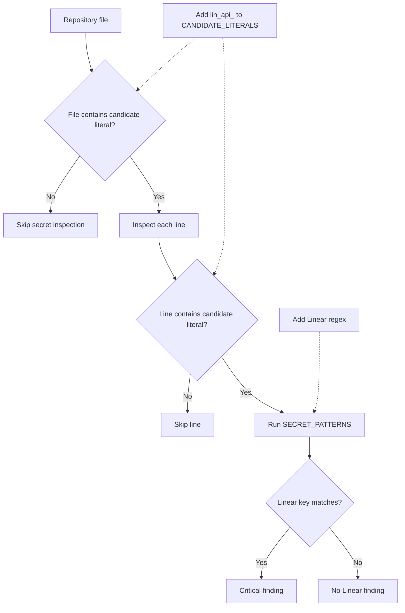

# RepoDx #63: Closing a Gap in Linear API Key Detection

## Overview

My first open-source contribution addressed a missing credential detector in [RepoDx](https://github.com/omerbek/repodx), a single-file Python tool that checks repositories for exposed secrets before code is pushed. [Issue #63](https://github.com/omerbek/repodx/issues/63) concerned Linear personal API keys: RepoDx failed to flag tokens beginning with `lin_api_`. The fix was small, but verifying it required understanding how its scanning pipeline worked. My changes and regression tests were incorporated into the maintainer's [PR #85](https://github.com/omerbek/repodx/pull/85), which merged and closed the issue.

## What happened

### Finding a Tractable Issue

Finding the right issue was more challenging than writing the final fix. I needed work that mattered to a real project, matched my Python experience, and could be reproduced and tested. An initial scan on November 11 surfaced three candidates; two were fixed by others before I returned. On November 22, a fresh scan reviewed **398 unique issues**, retained **51**, graded **five**, and accepted **one**: RepoDx #63.

I built reusable AI-assisted workflows to help discover, assess, reproduce, and verify issues. These skills improved the consistency of my decisions, but required their own checks. For example, I revised a scout criterion from `scope-fits` to `scope-feasible` and recorded difficulty separately, avoiding the assumption that ambitious work was automatically out of scope. The workflow supported judgment rather than replacing it.

### Root Cause: Two Gates, Not One

RepoDx's `check_file_contents` does not run every regular expression against every line. `CANDIDATE_LITERALS` first filters files (line 789), then lines (line 797). Only content passing those filters reaches `SECRET_PATTERNS`. Linear keys were absent from **both** lists. Adding a regex alone could therefore pass an isolated matching test and still miss the key during a repository scan.



*Both the candidate filter and regex detector must recognize the key for full-file scanning to work.*

### Implementation and Evidence

I first committed a failing provider-key test (`bcac446`). Using a fake key constructed at runtime, the original code returned no finding where a critical Linear finding was expected:

```text
FAIL: test_detects_provider_keys (name='Linear API key')
- []
+ [('secret', 'critical', 'Linear API key')]
Ran 115 tests ... FAILED (failures=1)
```

The production fix added exactly two entries:

```python
# SECRET_PATTERNS
("Linear API key", r"\blin_api_[A-Za-z0-9]{40}\b")

# CANDIDATE_LITERALS
"lin_api_"
```

I then tested the complete scanning path by placing a synthetic key on line 2 of `src/config.js`. This regression test exposed a **half-fix**: with the regex added but the candidate literal omitted, the full-file test still failed.

With both changes, the scan reported `1 critical, 3 warnings, 1 info`, compared with `0 critical, 3 warnings, 1 info` before.

All **117 tests passed** on Python 3.13.2 and 3.9.6; the project check reported `100/100 (A)`.

Two process failures clarified the importance of testing assumptions. My first reproduction explanation incorrectly claimed an environment-variable reference would bypass the line filter. A repro-check rejected it; I replaced the claim with evidence showing that regex-only detection succeeded while the full report remained empty.

Separately, my PR gate blocked a branch name for missing an issue number, although RepoDx had no such rule. I corrected the gate's rubric rather than enforcing a requirement the project had not made.

### Upstream Outcome

I opened [PR #84](https://github.com/omerbek/repodx/pull/84) at 00:07 EST on November 23. At 00:28, the maintainer merged [PR #85](https://github.com/omerbek/repodx/pull/85), crediting #84 while resolving a conflict with a Sentry detector from #83.

**My PR was closed, not merged directly**; its detector and three tests landed through #85.

When my monitoring workflow misread that closure as a rejection, I added a rule to inspect cross-referenced PRs and commits before drawing conclusions.

## Limitations and what's next

The regex assumes exactly 40 alphanumeric characters after `lin_api_`; that length is not established as universal by the evidence available. It also excludes `lin_oauth_` tokens. Future work should verify supported formats and expand test coverage accordingly.

### Reflection

This contribution showed me that reliable open-source work involves problem selection, system understanding, tests that exercise real behavior, and respect for maintainers' conventions. AI-assisted workflows made those steps more repeatable, but their mistakes also needed correction.

I see open source as a way to pool limited time, expertise, and computing resources: individually small, verifiable contributions can accumulate into software that none of us would build alone.

I'm grateful to **CodePath** for encouraging this first contribution.